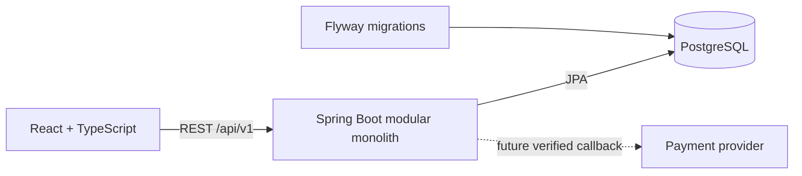

# Modular monolith architecture

One developer ships one Spring Boot deployment and one React application over 4–6 weeks. A single PostgreSQL database and in-process service calls keep deployment and debugging manageable. REST endpoints live under `/api/v1`.

## Backend boundaries

Base package: `com.transport.ticketbooking`. The implemented shared infrastructure is `config`, `security`, `common.exception`, and `common.response`. Each `modules` package has a package description; controllers, services, repositories, entities and DTOs will be created only when a real use case needs them.

| Module | Ownership |
| --- | --- |
| auth | Registration, login, authentication lifecycle; no JWT yet |
| user | Profiles and roles |
| route | Routes and stop information |
| vehicle | Bus/train fleet, train carriages and seat layout |
| trip | Ordered stops, schedules, origin/destination fares and trip seat inventory |
| booking | Passenger details, atomic seat allocation across journey segments, booking lifecycle |
| payment | Payment attempts, verified callbacks and reconciliation |
| ticket | Ticket issuance after confirmed payment |

Controllers validate request DTOs and delegate to services. Services own business rules and transaction boundaries. Repositories remain internal to their module. Business modules should communicate through services/DTOs. The small auth/user foundation shares UserRepository internally for registration and Spring Security account lookup; no JPA entity is returned through REST. API responses use `{success,message,data}`; framework endpoints such as Actuator and OpenAPI retain their native formats.

## Security foundation

GET health/CSRF and POST registration/login are public; writes still require CSRF. Local documentation is public only in the local profile. Spring Security authenticates BCrypt passwords against PostgreSQL and persists authentication in HttpOnly, SameSite=Lax cookie sessions. Login rotates session ID/CSRF; logout invalidates the session. CORS allows credentials only for explicit configured origins. Production HTTPS requires SESSION_COOKIE_SECURE=true.

Backend `/api/v1/admin/**` requires ADMIN; `/api/v1/customer/**` requires CUSTOMER. Other non-public paths require authentication. React guards enforce the same page roles for usability. Business pages are still skeletons; future booking APIs must additionally enforce ownership. See [authentication](authentication.md) for APIs, session limitations, creating a local admin and tests.

## Frontend boundaries

`app` composes providers and routing; `components` owns reusable UI/layout; `features` owns search validation/sample presentation and authentication context; `pages` connects feature UI to routes; `services/api` owns Axios and API calls; `types` defines transport contracts. Additional feature, utility and asset directories are added only when used. TanStack Query manages server state. Authentication Context loads `/auth/me` and manages loading/authenticated/anonymous/error states. RHF + Zod validate login, registration and sample search. Axios fetches CSRF before mutations and sends credentials; business query caches are removed on account changes.

The API health indicator mounts only in Vite development builds, handles loading/failure/retry, and polls every 30 seconds. The business search API is not implemented. UI sample data is visibly labeled and never used as database seed data.

## Data and future extension

Flyway owns schema evolution; Hibernate validates it. V1 executes a baseline statement only, allowing Flyway to record initialization without unreviewed entities. Keep monetary amounts as decimal values and specify currency in the reviewed model. Store instants consistently in UTC; display dates in the user's locale.

Future booking must use transactional seat allocation with a database uniqueness constraint, bounded seat holds, expiry and concurrency tests. Payments require provider signature verification and idempotent callbacks. A browser redirect alone must never confirm payment. Issue tickets only after the persisted payment state is confirmed.

Both buses and trains are required in the MVP. The approved [17-table model](database-design.md) includes carriages, ordered stops and segment allocations. Seat availability is determined for the requested journey segments, not by a single booked flag for an entire trip. Keep this within the existing modular monolith.
