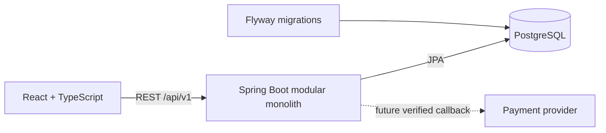

# Modular monolith architecture

One developer ships one Spring Boot deployment and one React application over 4–6 weeks. A single PostgreSQL database and in-process service calls keep deployment and debugging manageable. REST endpoints live under `/api/v1`.

## Backend boundaries

Base package: `com.transport.ticketbooking`. The implemented shared infrastructure is `config`, `security`, `common.exception`, and `common.response`. Each `modules` package has a package description; controllers, services, repositories, entities and DTOs will be created only when a real use case needs them.

| Module | Ownership |
| --- | --- |
| auth | Registration, login, authentication lifecycle; no JWT yet |
| user | Profiles and roles |
| route | Routes and stop information |
| vehicle | Bus fleet and seat layout; train extension later |
| trip | Schedules, fares and per-trip seat availability |
| booking | Passenger details, seat holds, booking lifecycle |
| payment | Payment attempts, verified callbacks and reconciliation |
| ticket | Ticket issuance after confirmed payment |

Controllers validate request DTOs and delegate to services. Services own business rules and transaction boundaries. Repositories remain internal to their module. Cross-module calls use service interfaces or explicit DTOs, not direct access to another module's repository or JPA entity. API responses use `{success,message,data}`; framework endpoints such as Actuator and OpenAPI retain their native formats.

## Security foundation

Only GET `/api/v1/health` and GET `/actuator/health` are public by default. GET documentation routes are public only in the `local` profile. Documentation is disabled in the default profile. All other routes require authentication, but no login mechanism, generated default account, JWT or mock token is provided. CSRF and default security headers remain enabled. BCrypt is ready for password hashing. CORS accepts explicitly configured origins and does not enable credentialed requests.

Customer/admin React routes are labeled previews and expose no real data. They are not authorization controls. Before introducing business data, implement backend role/ownership checks and frontend route guards together. Choose the authentication lifecycle and revisit CORS/CSRF based on that design.

## Frontend boundaries

`app` composes providers and routing; `components` owns reusable UI/layout; `features` owns search validation/sample presentation and authentication context; `pages` connects feature UI to routes; `services/api` owns Axios and API calls; `types` defines transport contracts. Additional feature, utility and asset directories are added only when used. TanStack Query manages server state. Authentication Context explicitly reports `not-implemented` and never simulates a secure user. RHF + Zod validate the demonstration search form.

The API health indicator mounts only in Vite development builds, handles loading/failure/retry, and polls every 30 seconds. The business search API is not implemented. UI sample data is visibly labeled and never used as database seed data.

## Data and future extension

Flyway owns schema evolution; Hibernate validates it. V1 executes a baseline statement only, allowing Flyway to record initialization without unreviewed entities. Keep monetary amounts as decimal values and specify currency in the reviewed model. Store instants consistently in UTC; display dates in the user's locale.

Future booking must use transactional seat allocation with a database uniqueness constraint, bounded seat holds, expiry and concurrency tests. Payments require provider signature verification and idempotent callbacks. A browser redirect alone must never confirm payment. Issue tickets only after the persisted payment state is confirmed.

For trains, extend vehicle/seat layout modeling to coaches and travel segments after requirements are understood. Do not introduce speculative inheritance hierarchies or a separate service now.
